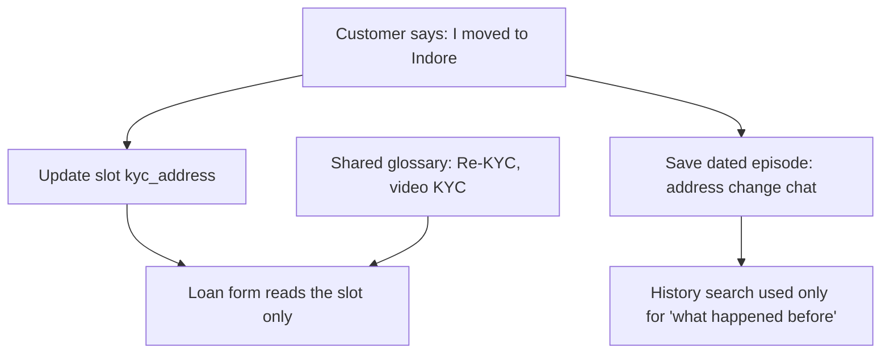

# Keep a customer's current facts apart from history

A lending app's support agent helps a customer who moved from Pune to Indore and redid KYC. Last month's chat still says Pune, so the agent finds two addresses while pre-filling a loan form.

## Quick diagnosis

| Symptom | Why it happens | Quick fix |
|---|---|---|
| Form pre-filled with old city | Old chat summary matches the search | Keep address in a labelled slot |
| Agent asks "Pune or Indore?" | Both versions sit in one store | Search history only when asked |
| Facts of one customer show for another | No per customer boundary | Scope every read and write by customer id |
| "Re-KYC" explained differently each time | Term lives inside chats | Put it in a shared glossary |

## How it works



Customer says it > slot updated and episode saved > form reads the slot, history stays on the side.

## Building blocks

| Part | What it does | Why it matters |
|---|---|---|
| Current facts | One labelled slot per fact, overwritten | Only one answer exists |
| Episodes | Dated summaries of past chats | Keeps the story, not the truth |
| Procedures | Saved steps like how a Re-KYC is done | Same steps every time |
| Shared glossary | Terms for the whole project | One meaning for everyone |

## Implementation

A tiny in-memory version: facts are overwritten, episodes are only added.

```python
from datetime import date

facts = {}      # (customer_id, label) -> value
episodes = []   # history, never used to fill forms
glossary = {"Re-KYC": "Repeat KYC after a change in details"}

def update_fact(cid, label, value):
    facts[(cid, label)] = value          # overwrite, no duplicates

def add_episode(cid, summary):
    episodes.append({"cid": cid, "date": str(date.today()), "text": summary})

def prefill(cid):
    # the form only ever reads current facts
    return {"address": facts.get((cid, "kyc_address"))}

update_fact("C1", "kyc_address", "Pune")
update_fact("C1", "kyc_address", "Indore")
add_episode("C1", "Customer moved from Pune to Indore, did Re-KYC")
print(prefill("C1"))  # {'address': 'Indore'}
```

- Use a real store with a customer id on every record.
- Let a model extract facts from chats, then call `update_fact`.
- Search episodes only for questions about the past.

## Why a mixed store goes wrong

- **Search is by meaning:** "address" matches both the old chat and the new one.
- **No sense of time:** the store does not know which version is newer unless it is told.
- **Small mistakes cost:** a wrong city on a loan form can mean a failed check or a rework.
- **KYC data is sensitive:** keeping it in clear slots makes it easier to review and to correct.

## Decisions and trade-offs

| Decision | Why | Trade-off |
|---|---|---|
| Fixed labels like `kyc_address` | One slot, one value | Need to plan labels early |
| Separate history store | No clash with current facts | Two places to maintain |
| Extraction in background | Keeps chat fast | New fact appears from next session |

## When to use it (and when not to)

Use it when:
- Facts change, like address, phone or income
- Wrong data in a form has a cost

Skip it when:
- Every chat is anonymous and one-off
- Nothing the agent remembers ever changes

## Checklist

- [ ] List facts that can change
- [ ] Give each a fixed label per customer
- [ ] Save changes as dated episodes
- [ ] Keep shared terms in a glossary
- [ ] Scope all reads by customer id
- [ ] Use recent turns for the current chat

## My takeaway

If a fact can change, give it one slot and update it. Put the story of the change in history, so the agent never has to choose between two addresses.
